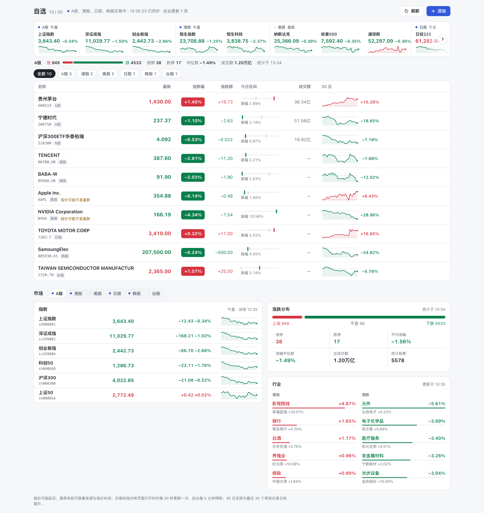

# stock-analysis-plugin

[](https://www.npmjs.com/package/stock-analysis-plugin)
[](https://pypi.org/project/stock-analysis-plugin/)
[](LICENSE)
[](https://www.python.org/)

给 AI Agent 用的股票研究工具箱，覆盖 **A 股、港股、美股、日股、韩股、台股**。装进你常用的 Agent 后，直接用自然语言查行情、做个股分析、全市场选股、写策略回测、做盘后复盘。

同一套 Python 工具同时支持 [Pi Agent](https://github.com/earendil-works/pi)、[Hermes Agent](https://github.com/NousResearch/hermes-agent)、[OpenClaw](https://github.com/openclaw/openclaw)、[DeepSeek Harness (dsh)](https://github.com/deepseek-ai/deepseek-harness)，也能作为 MCP 服务器接入 Claude Desktop、Cursor、WorkBuddy。



<sub>dsh Web / Desktop 中的「股票仪表盘」，真实行情截图。</sub>

## 能做什么

- **个股分析**：「帮我分析贵州茅台」——行情、技术面、财务、资金流、新闻与舆情汇总成一份研报，并标注哪些数据缺失或过期。
- **全市场选股**：「A 股里找 PE < 30、市值 > 100 亿的成长股」——多因子硬筛，再由模型排序给出候选。
- **策略回测**：用 YAML 描述买卖条件，回测、诊断，按需调参。
- **盘后复盘**：指数、涨跌家数、板块轮动、涨停池、龙虎榜和市场情绪温度。
- **价值投资数据**：估值分位、股息、股东结构、ETF 折溢价、财报日历、公告，以及美股 SEC 13F / Form 4。
- **持仓与风控**：组合集中度、压力测试、调仓计划和仓位计算；只计算你本次传入的数据，不保存账户。
- **策略视角**：缠论、波浪理论、龙头战法、情绪周期等 18 套方法论，以 Skill 形式按需调用。
- **dsh 仪表盘**：在 dsh Web / Desktop 侧栏看自选股和六个市场的行情，后台预热，打开即显示。

一共 73 个工具、21 个 Skills，11 个数据源自动容灾。大部分功能不需要任何 API Key。

## 快速开始

需要本机有 **Python ≥ 3.10**。插件安装时会在包目录下创建 `.venv` 并装好依赖；dsh 和 OpenClaw 默认不执行安装脚本，处理方法见下方注意事项。

| 你在用 | 安装 | 详细说明 |
|--------|------|----------|
| Pi Agent | `pi install npm:stock-analysis-plugin` | [Pi 接入指南](docs/pi-integration.md) |
| Hermes Agent | `pip install stock-analysis-plugin` | [Hermes 接入指南](docs/hermes-integration.md) |
| OpenClaw | `openclaw plugins install npm:openclaw-stock-analysis` | [OpenClaw 接入指南](docs/openclaw-integration.md) |
| DeepSeek Harness (dsh) | `dsh plugin --profile <profile> add dsh-stock-analysis` | [dsh 插件说明](dsh/README.md) |
| Claude Desktop / Cursor / WorkBuddy（MCP） | `pip install stock-analysis-plugin`，运行 `stock-analysis-mcp` | [MCP 接入指南](docs/mcp.md) |

每个 npm 包也以 `@weaxs/` scoped 名发布（如 `@weaxs/dsh-stock-analysis`），内容一致。装的是 scoped 版时，配置里引用包名的地方也用 scoped 名。

装好后试试：

```
帮我分析贵州茅台（600519）
从 A 股中筛选低估值高成长的股票：PE < 30、PB < 5、市值 > 100 亿
用 RSI 超卖反弹策略回测茅台，时间段 2024 年全年
用缠论分析一下 600519 当前的走势结构
今天 A 股复盘
```

也可以显式调用 Skill，例如 `/skill:stock-analysis`、`/skill:wave-theory`。

### 各宿主的注意事项

**Pi**：加 `-l` 只装到当前项目，或直接 clone 源码使用。启动后输入 `/skills` 确认已加载。Pi 1.5.2 及以上提供原生 `tool_search` 时，插件只在命中时加载完整工具定义；可用中文关键词或工具名搜索，例如 `实时行情`、`get_quote`。

**Hermes**：通过 `hermes_agent.plugins` entry point 自动发现，无需复制目录；也可以在 Python 中 `from hermes import register; register(ctx)`。

**OpenClaw**：OpenClaw 安装 npm 插件时带 `--ignore-scripts`，不会自动建 `.venv`。装完后在插件目录（`openclaw plugins inspect stock-analysis --runtime --json` 的 `installPath`）运行一次 `node scripts/setup-python.mjs`。ClawHub 上只有 scoped 名：`clawhub:@weaxs/openclaw-stock-analysis`。

**dsh**：dsh 用 pnpm 安装插件，默认不执行第三方安装脚本。若 `.venv` 没有建起来，在 profile 的 `pnpm-workspace.yaml` 中给 `dsh-stock-analysis` 配置 `allowBuilds`，否则会回退系统 `python3`。新版 dsh 默认通过 `stock_tool_search` 按需加载工具，可用 `toolDiscovery: false` 关闭。

**MCP**：源码方式运行 `.venv/bin/python mcp_host/server.py`，或 `python -m mcp_host`。客户端配置示例见 [MCP 接入指南](docs/mcp.md)。

## dsh 股票仪表盘

装了 dsh 插件的 Web / Desktop 会在侧栏出现「股票仪表盘」：

- **自选股行情表**：最新价、涨跌幅、今日区间、成交额和 30 日走势，可排序、按市场筛选；最多 30 只，支持六个市场。
- **市场概览**：顶部六市场指数带和 A 股涨跌分布；下方可切换市场查看指数，A 股另有涨跌统计和行业领涨、领跌榜。
- **打开即显示**：插件在后台常驻预热行情，页面只读内存快照；交易时段约 30 秒更新一次。
- **与 Agent 共享**：Agent 可以用 `get_watchlist` 读取同一份自选股。

刷新节奏、数据来源和存储位置见 [dsh 插件说明](dsh/README.md#股票仪表盘web--desktop)。

## 支持的市场

| 代码格式 | 示例 | 市场 | 行情报价 Failover 链（K 线差异见下方） |
|----------|------|------|---------------------|
| 6 位纯数字 | `600519`, `000001`, `300750` | A 股 | 腾讯 → akshare → tushare → efinance → 新浪 |
| 6 位纯数字（51/52/56/58/15/16/18 开头） | `510300`, `159915` | A 股 ETF | 腾讯 → akshare（ETF/全市场接口）→ tushare → efinance → 新浪 |
| 带交易所前缀（`sh`/`sz`/`bj` + 6 位数字） | `sh000001`（上证指数）, `sz399006`（创业板指） | A 股（显式指定，含指数） | 腾讯 → 新浪 |
| `.HK` 结尾 | `00700.HK`, `09988.HK` | 港股 | yfinance → 腾讯 → finnhub → longbridge |
| 英文字母 | `AAPL`, `GOOGL`, `TSLA` | 美股 | yfinance → finnhub → longbridge → 腾讯 → alphavantage |
| `.T` 结尾 | `7203.T` | 日股 | yfinance |
| `.KS` / `.KQ` 结尾 | `005930.KS`, `036020.KQ` | 韩股 | yfinance |
| `.TW` / `.TWO` 结尾 | `2330.TW`, `6510.TWO` | 台股 | yfinance |

各数据源按优先级自动尝试，失败后切换到下一个；未配置 API Key 的数据源自动跳过。A 股单票报价优先使用腾讯和新浪，不依赖东财域名，境外网络通常也能用。港股备用源、指数前缀、K 线复权口径等细节见 [数据源与数据口径](docs/data-sources.md)。

## 可选配置

不配置任何环境变量也能使用。下面这些配置后会加入容灾链，或启用搜索、舆情和 SEC 数据：

<details>
<summary>环境变量列表</summary>

**数据源（可选，配置后自动加入 Failover 链）：**

| 环境变量 | 用途 |
|---------|------|
| `TUSHARE_TOKEN` | Tushare 数据源（A 股 K 线 / 行情） |
| `LONGBRIDGE_APP_KEY` | Longbridge SDK（港股 / 美股） |
| `LONGBRIDGE_APP_SECRET` | Longbridge SDK |
| `LONGBRIDGE_ACCESS_TOKEN` | Longbridge SDK |
| `ALPHAVANTAGE_API_KEY` | Alpha Vantage（美股 K 线 / 行情） |
| `FINNHUB_API_KEY` | Finnhub（港股 / 美股） |
| `XUEQIU_TOKEN` | 雪球（A 股个股所属板块反查，东财不可用时的兜底） |
| `LIXINGER_TOKEN` | 理杏仁：指数 PB 与港股非金融公司财务、每日估值（需对应权限） |
| `SEC_USER_AGENT` | SEC EDGAR 身份声明：应用名称与真实联系邮箱，13F / Form 4 必需 |

**搜索引擎（可选，配置任一即可）：**

| 环境变量 | 用途 |
|---------|------|
| `TAVILY_API_KEY` | Tavily 搜索 |
| `BRAVE_API_KEY` | Brave 搜索 |
| `SERPAPI_KEY` | SerpAPI |
| `BOCHA_API_KEY` | Bocha AI 搜索 |
| `SEARXNG_BASE_URLS` | SearXNG 自建实例地址（逗号分隔多个，无需 Key，兜底用） |

**社交舆情（可选）：**

| 环境变量 | 用途 |
|---------|------|
| `SENTIMENT_API_URL` | 舆情 API 地址（默认 `https://api.adanos.org`） |
| `SENTIMENT_API_KEY` | 舆情 API 密钥 |

</details>

## Skills 一览

### 核心 Workflow（3 个）

| Skill | 调用方式 | 功能 |
|-------|----------|------|
| 综合分析 | `/skill:stock-analysis` | 技术面 + 基本面 + 资金面 + 消息面多维研判，输出结构化研报 |
| 全市场选股 | `/skill:stock-screener` | L1 多因子硬筛（市场情绪调节，可选 `--l2` 量化增强）→ L2 LLM 智能排序 → 输出推荐列表 |
| 策略回测 | `/skill:strategy-backtest` | YAML 策略定义 → 回测 → 诊断；按需进行最多 3 轮参数优化 |

### 策略、复盘与研究（18 个）

| Skill | 调用方式 | 方法论 |
|-------|----------|--------|
| 趋势追踪 | `/skill:bull-trend` | 均线排列 + MACD 方向 + 趋势阶段判断 |
| 缩量回调 | `/skill:shrink-pullback` | 上升趋势中的缩量洗盘识别 |
| 均线金叉 | `/skill:ma-crossover` | MA5/10/20/60 交叉信号 + 金叉质量评估 |
| 放量突破 | `/skill:volume-breakout` | 关键阻力位的放量突破确认 |
| 底部放量 | `/skill:bottom-volume` | 底部区域异动放量 → 主力建仓信号 |
| 龙头战法 | `/skill:dragon-head` | 板块龙头识别 + 龙头 vs 跟风判断 |
| 缠论 | `/skill:chan-theory` | 笔 → 段 → 中枢 → 背驰 → 买卖点 |
| 波浪理论 | `/skill:wave-theory` | Elliott 5 浪推动 + 3 浪调整 + 斐波那契 |
| 箱体震荡 | `/skill:box-oscillation` | 箱体区间识别 + 支撑压力间波段操作 |
| 情绪周期 | `/skill:emotion-cycle` | 市场情绪冰点 → 回暖 → 狂热 → 退潮周期判断 |
| 一阳穿三阴 | `/skill:one-yang-three-yin` | K 线形态识别 + 反转信号质量评级 |
| 事件驱动 | `/skill:event-driven` | 公告/政策/业绩事件的影响路径与失效条件 |
| 预期重估 | `/skill:expectation-repricing` | 市场预期与实际数据的偏差 |
| 成长质量 | `/skill:growth-quality` | 收入、利润、现金流与盈利能力的多期验证 |
| 行业 ETF 轮动研究 | `/skill:sector-rotation` | 确定性集中度/配权计算、跨市场分组的配权分项回测；完整深度模型尚未实现 |
| 热点题材 | `/skill:hot-theme` | 板块强度、扩散度、关联度与节奏 |
| 市场复盘 | `/skill:market-review` | 指数、宽度、板块、温度与次日策略 |
| Wisburg 投研 | `/skill:wisburg-research` | 检索机构研报、公告、电话会纪要和市场日报 |

## 工具列表

73 个工具按用途分组：

| 类别 | 数量 | 主要内容 |
|------|------|----------|
| 数据获取 | 28 | K 线、报价、基金净值、资金流、财务、板块、涨停池、龙虎榜、两融、估值历史、股东、ETF、股息、公告、SEC |
| 分析计算 | 9 | 技术指标、K 线形态、量价、异动、信号胜率、趋势与行业轮动研究 |
| 筛选与回测 | 8 | 多因子选股、风险筛查、策略回测、市场状态、日度复盘、自选股批量分析 |
| 搜索与舆情 | 5 | 新闻搜索、综合情报、社交情绪、正文提取 |
| 辅助 | 7 | 名称/拼音解析、交易日历、交易时段、数据源诊断、股票列表解析 |
| 上下文与报告 | 8 | 自选股上下文、持仓分析、告警规则、信号记录与评估、研报渲染 |
| 无状态研究与风险计算 | 8 | 同行比较、公告变更、组合风险、调仓计划、仓位计算、事件研究、回测稳健性 |

<details>
<summary>完整工具列表（73 个）</summary>

#### 数据获取

| 工具 | 说明 |
|------|------|
| `get_announcements` | A 股巨潮公告 / 美股 SEC 申报：类别/日期范围/标题与原文链接；美股需 SEC_USER_AGENT |
| `get_us_holdings` | SEC 机构组合 / 发行人 CIK 反查机构：精确 CUSIP 映射、季度数据与修订处理（需 SEC_USER_AGENT） |
| `get_insider_trades` | SEC 股票 ticker/发行人 CIK 的 Form 4 内部人交易、代码和脚注 |
| `get_valuation_history` | A/HK PE-TTM/PB 历史、正值分位与估值 Band，实际采样窗口 |
| `get_index_valuation` | 中国指数 PE/PB 历史水位；中证官方多年滚动 PE；可选理杏仁补充 PB |
| `get_earnings_calendar` | A 股报告期披露与业绩预告；HK 董事会排期；US/JP yfinance 预计日期（provider_only，非官方确认） |
| `get_shareholder_structure` | A 股股东户数/十大流通股东变化/报告期北向名义持股；HK 南向持股 |
| `get_etf_details` | A 股 ETF 净值折溢价、规模变动、披露持仓、可选基准成分与跟踪误差 |
| `get_dividends` | A/HK/US/JP/KR/TW 历史分红与除息日历、已实现 TTM 股息；排行仍仅 A/HK |
| `get_kline` | K 线数据（OHLCV），支持日/周/月线；A 股股票/ETF 前复权，每条记录 `adjusted=qfq`，指数 `adjusted=none` |
| `get_quote` | 实时行情快照（非交易时段返回最近交易日收盘价并以 as_of/stale 标注；`pe_basis` 区分 dynamic/trailing/unknown；ETF 的 premium_discount_rate 为正=溢价、负=折价）；场外基金用 `get_fund_quote`，TIAAxxxxxx 返回投顾组合识别、`advisor_org` 与无统一净值提示；长钱/海外长钱/稳钱另有有知有行 `official_disclosures`（`partial=true`，非实时完整持仓）；其他组合搜索可用时为 `search_partial`，否则 `unsupported_provider` |
| `get_fund_quote` | 6 位场外公募基金净值；`nav` 是 `nav_date` 对应的已披露日终净值而非实时价，`accumulated_nav` 为累计净值、`change_pct` 为日涨跌幅；`estimated_nav` 可能为 `null`，QDII 净值可能滞后 1-2 交易日 |
| `get_capital_flow` | 资金流向（仅 A 股） |
| `get_news` | 个股相关新闻 |
| `get_financials` | 财务指标 |
| `get_stock_info` | 股票基本信息 |
| `get_chip_distribution` | 筹码分布 |
| `get_market_indices` | 主要指数行情 |
| `get_sector_rankings` | 板块涨跌排行（行业/概念） |
| `get_sector_constituents` | 板块成分股查询（仅 A 股，板块名模糊匹配） |
| `resolve_stock_sectors` | 个股所属板块查询（A 股行业+概念 / 港股 GICS） |
| `get_market_stats` | 市场统计（涨跌家数、涨停等） |
| `get_limit_up_pool` | 涨停池/涨停板复盘（连板数、封板资金、炸板次数等，仅 A 股；非交易日自动回退到最近交易日并以 requested_date/stale 标注） |
| `get_dragon_tiger` | 龙虎榜（净买额/上榜原因/解读，仅 A 股；非交易日自动回退到最近交易日并以 requested_date/stale 标注） |
| `get_hot_stocks` | 全市场人气热搜榜（东财→百度，仅 A 股） |
| `get_margin_trading` | 个股融资融券明细（融资余额/融资买入额/融券余量等，沪深交易所官方数据，仅 A 股两融标的；金额单位为元，short_*_shares 单位为股） |
| `get_northbound_flow` | 北向资金市场级净买入序列（东财沪深港通历史数据；2024-08-16 起交易所停止披露日度净买额，仅 2024-08 之前历史数据可查，仅 A 股） |
| `get_fundamental_context` | 基本面综合上下文 |

#### 分析计算

| 工具 | 说明 |
|------|------|
| `calculate_rotation_metrics` | 真实MC-dropout分布集中度与历史原始配权计算；不生成预测或买入信号 |
| `backtest_rotation_allocation` | 股票/ETF代码自动取数，按市场与报价币种独立比较等权和历史配权；分项回测，非完整论文模型 |
| `analyze_trend_strategy` | 月度右侧趋势策略：单市场股票池筛选、真实旧仓保持/退出与逆波动新仓预算；直接传股票代码、自动取行情，无持仓存储，仍为not_validated |
| `get_technical_analysis` | 全面技术指标分析（MA/MACD/RSI/BOLL/KDJ；附实验性 trend_horizons 多期限月度趋势及独立趋势温度 trend_temperature；多周期共振时 resonance.direction ∈ aligned_bullish/aligned_bearish/divergent） |
| `analyze_pattern` | K 线形态识别 |
| `calculate_ma` | 多周期均线计算 |
| `get_volume_analysis` | 量价分析 |
| `evaluate_signal` | 历史信号胜率回测 |
| `detect_anomaly` | 当日技术、量价与资金异动扫描 |

趋势温度 `trend_temperature`、多期限趋势 `trend_horizons`、月度右侧趋势策略和市场环境入场实验均为 `not_validated` 的研究工具，公式、边界与验证局限见 [工具行为与可靠性 · 趋势研究](docs/tool-behavior.md#趋势研究)。

#### 筛选与回测

| 工具 | 说明 |
|------|------|
| `screen_stocks` | 全市场多因子筛选（流动性使用成交额 turnover；可选 L2；factor_coverage 展示缺失因子与实际权重） |
| `screen_risk` | 风险因子筛查 |
| `run_backtest` | YAML 策略回测，默认收盘信号于次日开盘成交，execution 返回模型与限制 |
| `detect_market_regime` | A/HK/US/JP/KR/TW 市场状态检测（返回实际 as_of 和警告；板块热点仅 A 股） |
| `get_market_review` | 市场日度复盘数据 |
| `get_review_history` | 复盘归档历史（最近 N 条，最新在前，用于纵向对比） |
| `get_watchlist` | 读取 dsh 仪表盘自选股，按首选写法返回代码；`600519` / `sh600519` 等价去重 |
| `run_watchlist_analysis` | 批量自选股分析 |

#### 搜索与舆情

| 工具 | 说明 |
|------|------|
| `search_stock_news` | 关键词搜索新闻 |
| `search_comprehensive_intel` | 综合情报搜索 |
| `get_social_sentiment` | 社交媒体情绪（A 股：东财股吧 + 雪球；美港股：Reddit / X / Polymarket） |
| `get_trending_sentiment` | 社交媒体热门趋势聚合（Reddit / X / Polymarket） |
| `extract_article` | 网页 / 公告 PDF 正文提取；`max_chars` 默认 3000、上限 200000，返回 `truncated` |

#### 辅助

| 工具 | 说明 |
|------|------|
| `resolve_stock_name` | A/HK/US 中文股票名、拼音与代码模糊匹配；港美名录单市场失败可降级 |
| `check_trading_day` | 查询是否交易日 |
| `get_trading_days` | 获取前后 N 个交易日；日历未覆盖的推测日期单列 `assumed_trading_days` |
| `get_trading_phase` | 查询市场当前交易时段（盘前/盘中/盘后/休市） |
| `diagnose_data_sources` | 诊断数据源、环境变量和市场链路 |
| `get_market_capabilities` | 查询各市场支持的工具边界 |
| `parse_stock_list` | 从自然语言、CSV 或 Markdown 解析股票列表 |

#### 上下文与报告

| 工具 | 说明 |
|------|------|
| `build_watchlist_context` | 构建自选股摘要与后续工具建议 |
| `analyze_position_context` | 结合成本、仓位与止损止盈分析持仓 |
| `check_alert_rules` | 无状态检查价格、涨跌幅、异动和风险规则 |
| `record_signal` | 记录 AI 分析建议信号（本地 JSONL 持久化） |
| `evaluate_signals` | 评估到期信号（target_hit/stop_hit/timeout 结算） |
| `get_signal_summary` | 信号胜率及分来源平均收益、有效收益样本数与小样本提示（按 source/symbol/status 过滤） |
| `render_stock_report` | 将结构化个股报告渲染为 Markdown，展示 evidence 与 data_quality 限制 |
| `render_market_report` | 将结构化市场复盘渲染为 Markdown（save=true 时归档到本地 JSONL） |

批量分析的成功判定、信号存储与结算、风险筛查缺失值、选股与回测字段语义见 [工具行为与可靠性](docs/tool-behavior.md#自选股批量分析信号与筛选)。

#### 无状态研究与风险计算

| 工具 | 说明 |
|------|------|
| `compare_stocks` | 比较显式输入的同行指标；检查单位、期间和口径，仅对可比数值排序 |
| `analyze_disclosure_changes` | 比较新旧公告正文与财务指标，返回来源、变更行号和增长率限制 |
| `analyze_portfolio_risk` | 一次性持仓的集中度、行业/币种敞口、价格盈亏、止损情景、可选相关性与市场/行业/个股/汇率压力测试 |
| `plan_portfolio_rebalance` | 按目标权重、整手、费用和现金约束生成先卖后买的调仓计划，返回未满足数量与调后敞口 |
| `calculate_position_size` | 按现金、风险预算、费用、滑点和交易单位计算本次可买数量 |
| `analyze_event_study` | 事件前一交易日收盘至各窗口的股票/基准收益差，标明缺失和重叠样本 |
| `validate_backtest` | 复用现有引擎，滚动训练选候选、样本外验证，比较参数及多个标的 |
| `compare_analysis_snapshots` | 比较调用方传入的快照，区分新增、删除、变化、数据失效和恢复 |

这些工具不保存自选股、账户或分析历史，也不提供调度/通知。输入格式、仓位预算示例与解读边界见 [工具行为与可靠性 · 无状态研究](docs/tool-behavior.md#无状态研究与风险计算)。

</details>

字段语义、部分失败和缺失数据的处理方式见 [工具行为与可靠性](docs/tool-behavior.md)。

## 策略回测

策略用 YAML 描述，支持参数化和条件组合：

```yaml
name: "RSI Oversold Bounce"
version: "1.0"
description: "RSI超卖反弹策略"

parameters:
  rsi_period: 14
  rsi_oversold: 30
  rsi_overbought: 70
  stop_loss: -0.05
  take_profit: 0.15

entry:
  conditions:
    - indicator: "rsi"
      period: "{rsi_period}"
      operator: "<"
      value: "{rsi_oversold}"
    - indicator: "volume_ratio"
      operator: ">"
      value: 1.0
  logic: "all"

exit:
  conditions:
    - indicator: "rsi"
      period: "{rsi_period}"
      operator: ">"
      value: "{rsi_overbought}"
  logic: "any"
  stop_loss: "{stop_loss}"
  take_profit: "{take_profit}"

position:
  size: 1.0
  max_positions: 1
```

可用指标包括 RSI、MA/EMA、MACD、量比、布林带位置、趋势强度和月度动量，运算符支持比较和 `cross_above` / `cross_below`。止损、移动止损、基准对比、成交口径和交易成本见 [回测 DSL 参考](docs/backtest-dsl.md)，示例策略在 `strategies/examples/`。

## 独立 CLI 使用

不接 Agent 也能直接用，所有命令输出 JSON：

```bash
python tools/stock_data.py quote 600519
python tools/stock_data.py kline AAPL --period weekly --count 30
python tools/technical.py analyze 600519
python tools/screener.py screen --market A --top 20
python tools/backtest.py run strategies/examples/rsi_oversold.yaml 600519 --start 2024-01-01 --end 2025-01-01
python tools/market_regime.py detect A
```

<details>
<summary>更多命令</summary>

```bash
# 行情数据
python tools/stock_data.py kline 600519
python tools/stock_data.py kline AAPL --period weekly --count 30
python tools/stock_data.py quote 600519
python tools/stock_data.py capital_flow 600519
python tools/stock_data.py news 600519 --days 5
python tools/stock_data.py financials AAPL

# 技术分析
python tools/technical.py analyze 600519
python tools/technical.py analyze AAPL --period weekly

# 全市场筛选
python tools/screener.py screen --market A --top 20
python tools/screener.py screen --market A --top 20 --l2
python tools/screener.py screen --market A --config my_filter.yaml

# 策略回测
python tools/backtest.py run strategies/examples/rsi_oversold.yaml 600519
python tools/backtest.py run strategies/examples/rsi_oversold.yaml 600519 --start 2024-01-01 --end 2025-01-01

# 搜索与舆情
python tools/search_intel.py search "茅台 业绩"
python tools/search_intel.py comprehensive 600519
python tools/search_intel.py sentiment 600519
python tools/search_intel.py sentiment AAPL
python tools/search_intel.py trending

# 风险筛查
python tools/risk_screening.py screen 600519

# 市场状态
python tools/market_regime.py detect A

# 估值、财报、股东、ETF 与分红
python tools/value_data.py valuation_history 600519 --years 5
python tools/stock_data.py financials 600519 --annual --periods 10
python tools/value_data.py earnings_calendar --report-date 2026-09-30 --symbol 600519
python tools/value_data.py shareholder_structure 600519 --report-date 2026-06-30
python tools/value_data.py shareholder_structure 0700.HK
python tools/value_data.py index_valuation 000300 --years 5
python tools/value_data.py etf_details 510300 --benchmark sh000300 --days 60
python tools/value_data.py etf_details 510300 --include-full-holdings
python tools/stock_data.py margin_trading 600519 --days 10 --include-ratio
python tools/value_data.py dividends --symbol 600519
python tools/value_data.py dividends --symbol 0700.HK --mode calendar
python tools/value_data.py dividends --mode ranking --report-date 2025-12-31
python tools/value_data.py dividends --mode ranking --market HK --report-date 2025-12-31
python tools/value_data.py earnings_calendar --symbol 0700.HK

# 公告与港股长期财务
python tools/value_data.py announcements 600519 --category forecast --start-date 2026-01-01 --end-date 2026-10-13 --top 50
python tools/stock_data.py financials 0700.HK --annual --periods 10
python tools/value_data.py valuation_history 0700.HK --years 10

# SEC 13F / Form 4（SEC_USER_AGENT 必须配置为应用名称 + 你的真实联系邮箱）
python tools/sec_edgar.py holdings 0001067983
python tools/sec_edgar.py insider_trades AAPL --days 90 --top 10
python tools/sec_edgar.py holdings 0000320193 --mode issuer   # 发行人 CIK 反查持仓机构
```

</details>

## 常见问题

**Python 工具报错 `ModuleNotFoundError`？**
运行 `pip install -r tools/requirements.txt`。使用 virtualenv / conda 时，确保 Agent 启动时用的是同一个 Python 环境。

**A 股数据获取失败？**
报价会依次尝试腾讯、akshare、tushare、efinance 和新浪，K 线另有 baostock 兜底。都失败时，检查网络、升级 akshare（`pip install --upgrade akshare`），或配置 `TUSHARE_TOKEN` 增加一个可靠数据源。

**港股 / 美股数据有延迟？**
yfinance 免费数据通常延迟约 15 分钟。配置 Longbridge（`LONGBRIDGE_APP_KEY` 等）或 Finnhub（`FINNHUB_API_KEY`）可获得更实时的数据。

**如何自定义选股条件？**
写一个 YAML，再运行 `python tools/screener.py screen --config my_filter.yaml --top 30`：

```yaml
name: "我的选股策略"
filters:
  pe_min: 5
  pe_max: 25
  pb_max: 3
  market_cap_min: 20e9
sort_by: "composite_score"
sort_order: "desc"
```

**如何编写回测策略？**
参考 `strategies/examples/` 和 [回测 DSL 参考](docs/backtest-dsl.md)，也可以直接让 Agent 帮你写。

## 参与开发

所有业务逻辑都在 `tools/*.py`，每个工具是一个输出 JSON 的 CLI。`pi/`、`hermes/`、`openclaw/`、`dsh/` 四个适配器只负责把宿主的工具调用转成子进程调用，`mcp_host/` 复用 Hermes 的工具定义。Skills 放在 `skills/*/SKILL.md`，四个宿主共用。

```bash
npm install                                   # 同时构建仓库 .venv
.venv/bin/python -m pytest -q                 # Python 单元测试（离线）
npx tsc --noEmit                              # TypeScript 类型检查
npx tsx tests/test_adapter_parity.ts          # 四个宿主的 73 个工具和参数映射一致
npm run build:openclaw && npm run build:dsh   # 构建 OpenClaw / dsh bundle
```

开发约定、完整测试命令和跨平台注意事项见 [AGENTS.md](AGENTS.md)。

<details>
<summary>项目结构</summary>

```
stock-analysis/
├── pi/                              # Pi Agent Extension
│   └── index.ts                     #   注册 73 个工具 + 21 个 skill
├── hermes/                          # Hermes Agent Plugin
│   ├── plugin.yaml                  #   插件清单
│   ├── __init__.py                  #   register(ctx) 入口
│   ├── schemas.py                   #   工具 JSON Schema 定义
│   └── tools.py                     #   73 个 handler → subprocess 调 CLI
├── openclaw/                        # OpenClaw Plugin
│   ├── openclaw.plugin.json         #   manifest（contracts.tools）
│   ├── package.json                 #   含 openclaw 块（pluginApi/SDK 版本）
│   └── index.ts                     #   definePluginEntry + registerTool ×73
├── dsh/                             # DeepSeek Harness (dsh) Plugin
│   ├── cordis.patch.yml             #   bundle patch（insert 插件入口）
│   ├── package.json                 #   dsh.bundle + dsh.client manifest
│   ├── index.ts                     #   cordis apply(ctx) + defineTool ×73
│   ├── dashboard.ts                 #   后台预热缓存 + 快照/自选股 HTTP API 与持久化
│   ├── client.ts                    #   侧栏入口 + 主面板 + 主题同步（编译为 dist/client.js）
│   └── web/                         #   仪表盘页面（app.ts 编译为 dist/web/app.js）
│
├── mcp_host/                        # MCP stdio 服务器（复用 Hermes schema/handler）
├── tools/                           # 共享 Python CLI 工具
│   ├── stock_data.py                #   行情 / 资金流 / 新闻 / 财务 / 短线情绪
│   ├── signal_tracker.py            #   AI 买卖建议回测闭环（本地 JSONL 存储）
│   ├── technical.py                 #   技术指标分析
│   ├── pattern.py                   #   K 线形态识别
│   ├── value_data.py                #   估值/财报日历/股东/ETF/股息
│   ├── _cache.py                    #   用户目录 TTL 缓存
│   ├── screener.py                  #   全市场多因子筛选（含市场情绪调节，--l2 量化增强）
│   ├── backtest.py                  #   策略回测引擎
│   ├── volume_analysis.py           #   量价分析
│   ├── search_intel.py              #   搜索 / 舆情 / 正文提取
│   ├── risk_screening.py            #   风险因子筛查
│   ├── market_regime.py             #   市场状态检测
│   ├── name_resolver.py             #   股票名称模糊匹配
│   ├── trading_calendar.py          #   交易日历
│   └── requirements.txt
│
├── skills/                          # 共享 SKILL.md（21 个）
│   ├── stock-analysis/              #   综合分析 workflow
│   ├── stock-screener/              #   选股 workflow
│   ├── strategy-backtest/           #   回测 + 进化 workflow
│   └── ...                          #   18 个策略方法论
│
├── strategies/examples/             # 回测策略 YAML 示例
├── schemas/                         # JSON Schema（研报结构等）
├── tests/                           # pytest 测试
├── package.json                     # npm / Pi 配置
└── tsconfig.json
```

数据流：

```
用户 (自然语言)
    │
    ▼
Agent (Pi / Hermes / OpenClaw / dsh / MCP)
    │
    ├── 加载 SKILL.md → 分析框架 / 流程指引
    │
    ├── 调用工具 → pi/index.ts、hermes/tools.py、openclaw/index.ts、dsh/index.ts 或 mcp_host/server.py → python tools/xxx.py → JSON
    │
    ▼
Agent (LLM 分析 + 生成报告)
    │
    ▼
用户看到结构化分析结果
```

</details>

<details>
<summary>Python 依赖</summary>

```bash
pip install -r tools/requirements.txt
```

主要依赖：

| 包 | 用途 |
|---|------|
| akshare | A 股数据源（行情、资金流、财务、新闻，含 A 股 ETF） |
| yfinance | 港股 / 美股 / 日股 / 韩股 / 台股数据源 |
| pandas / numpy | 数据处理和数值计算 |
| exchange-calendars | 交易日历（A/HK/US/JP/KR/TW） |
| newspaper4k / pypdf | HTML 新闻与公告 PDF 正文提取 |
| pypinyin | 股票名称拼音搜索 |
| longport | 港股 / 美股 Longbridge SDK |

</details>

<details>
<summary>报告质量评测与 CI 真实宿主测试</summary>

```bash
.venv/bin/python -m pytest tests/test_analysis_quality.py -q
# 需要 OPENAI_BASE_URL / OPENAI_API_KEY / OPENAI_MODEL；只调用模型，数据源使用固定夹具
.venv/bin/python -m pytest tests/e2e/test_analysis_quality.py -m integration_llm -v
```

GitHub Actions 的 `e2e-host` 使用 Pi、Hermes、OpenClaw、dsh 的真实运行时执行工具调用。在仓库 **Settings → Secrets and variables → Actions** 中配置以下三项，所有 E2E 共用：

| 名称 | 存放位置 | 内容 |
|---|---|---|
| `OPENAI_BASE_URL` | Variable 或 Secret | OpenAI 兼容的 API base URL，包含服务商要求的路径（例如 `/v1`） |
| `OPENAI_API_KEY` | Secret | 对应的 API key |
| `OPENAI_MODEL` | Variable 或 Secret | 支持 tool calling 的模型 ID |

`e2e-llm` 也使用这三项配置，Hermes（含报告质量评测）、Pi、OpenClaw 和 dsh 通过四个 matrix 作业并行运行，互不因失败而取消；同仓库 PR 和主分支推送会运行，fork PR 不读取 API key。`e2e-host` 缺少任一项时会失败。URL 和 model 同时存在于 Variable 与 Secret 时，优先使用 Secret。

</details>

## 致谢

- [daily_stock_analysis](https://github.com/ZhuLinsen/daily_stock_analysis) — A 股每日分析工具，本项目的综合分析流程参考了其设计思路
- [akshare](https://github.com/akfamily/akshare) — A 股数据源
- [yfinance](https://github.com/ranaroussi/yfinance) — 港股 / 美股数据源
- [longport](https://github.com/longbridge/openapi) — Longbridge OpenAPI（港股 / 美股）
- [exchange-calendars](https://github.com/gerrymanoim/exchange_calendars) — 全球交易日历

## License

MIT
