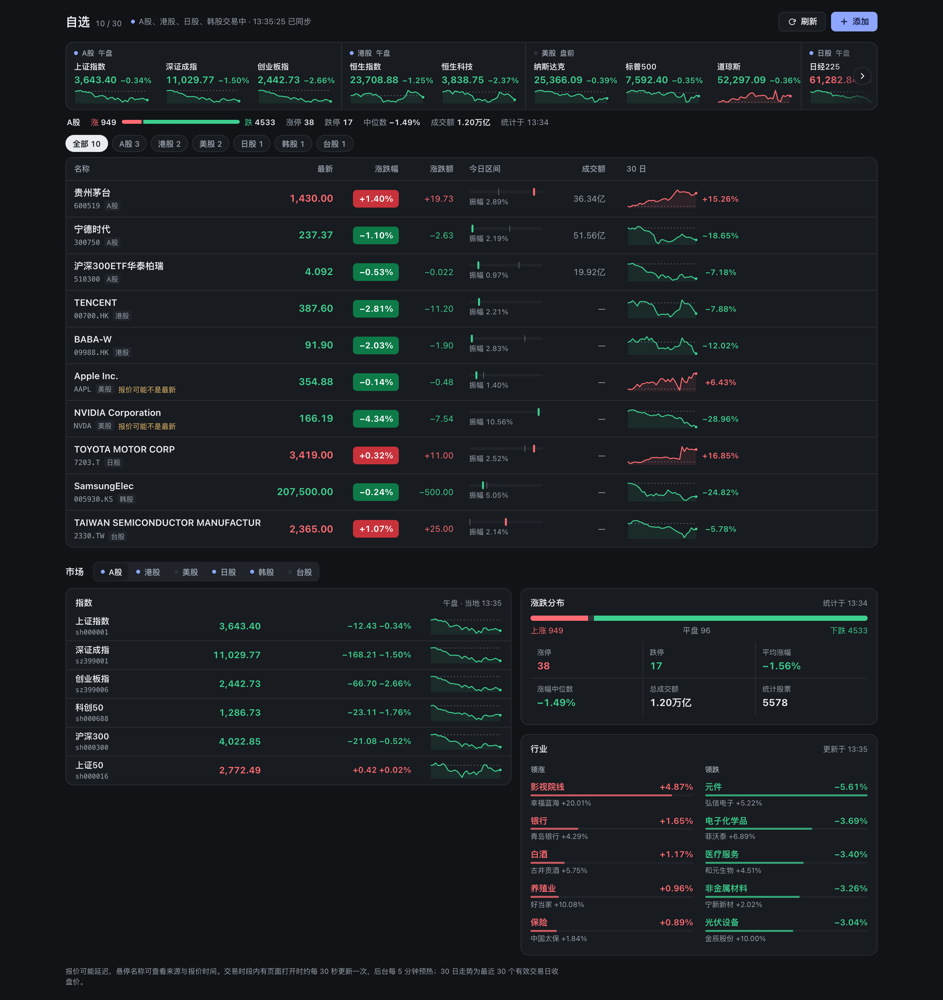

# Stock Analysis — DeepSeek Harness (dsh) Plugin

A 股 / 港股 / 美股 / 日股 / 韩股 / 台股的行情、技术分析、选股与回测。作为 dsh bundle 安装到 profile 后，对话中可调用 73 个工具，并自动注册 21 个工作流和策略方法论 Skill；dsh Web / Desktop 侧栏还会多出一个「股票仪表盘」。



## 安装

```bash
dsh plugin --profile <你的profile> add @weaxs/dsh-stock-analysis
dsh --profile <你的profile>
```

`dsh plugin add` 是 pnpm 的薄封装：安装后 dsh 会读取本包 `package.json` 里的 `dsh.bundle.patch`，把 `cordis.patch.yml` 作为一层叠加进 profile 组合。可用 `dsh --profile <你的profile> --dump-config` 验证 layer 已生效。

从源码安装（本仓库根目录）：

```bash
npm install && npm run build:dsh
dsh plugin --profile <你的profile> add ./dsh
```

### Python 运行时

工具实际逻辑在 `tools/*.py`，依赖 `akshare`、`pandas`、`numpy`、`requests`。本包的 postinstall（`scripts/setup-python.mjs`）会在包目录下自动建 `.venv` 并装好依赖，前提：本机有 `python3 >= 3.10`。依赖安装失败时 postinstall 会返回非零状态，避免 pnpm 缓存未装完整的 `.venv`；解决安装问题后重新安装插件即可。

注意：dsh profile 使用 pnpm 且默认不执行第三方包的安装脚本。如 postinstall 被跳过，请在 profile 的 `pnpm-workspace.yaml` 中允许：

```yaml
allowBuilds:
  "@weaxs/dsh-stock-analysis": true
```

如果 venv 最终没建起来，plugin 会回退到系统 `python3`（Windows 为 `python`），此时请自行 `pip install -r tools/requirements.txt`。

## 股票仪表盘（Web / Desktop）

支持 dsh 前端的宿主会在侧栏显示「股票仪表盘」。首屏是自选股行情表：最新价、涨跌幅、涨跌额、今日区间（振幅与昨收位置）、成交额和 30 日走势（悬停可看每日收盘与较首日涨跌），可按列排序、按市场筛选；上方是六市场指数带和 A 股涨跌分布，下方可切换 A / HK / US / JP / KR / TW 查看各市场指数与交易阶段，A 股另有涨跌统计和行业领涨/领跌榜。其他市场没有用少数指数推算全市场宽度。

自选股按代码添加，支持逗号批量导入和删除，最多 30 只，覆盖六个市场。列表保存在 `$STOCK_WATCHLIST_FILE`，未配置时保存到 `$DSH_HOME/stock-analysis/watchlist.json`（`DSH_HOME` 默认为 `~/.dsh`）。文件损坏时拒绝静默覆盖。

### 数据如何更新

数据由插件后台常驻预热：Web 路由注册后即开始按固定任务表调用现有 CLI（`stock_data.py quote/market_indices/kline/sector_rankings/market_stats` 与 `trading_calendar.py phase`），最多 4 个 Python 进程按优先级排队（报价 > 指数 > 走势 > 行业/统计），结果留在内存缓存。刷新节奏随各市场交易阶段变化：交易时段有页面打开时报价与指数约 30 秒、行业 1 分钟、全 A 统计 2 分钟；无人查看时放宽到 5–10 分钟；收盘后 30–60 分钟一次。失败保留上次成功值并标注，重试间隔按 1、2、4… 分钟退避。页面只轮询内存快照 `/api/snapshot`（有后台任务时 1.5 秒，否则 15 秒，页面不可见时停止），并在浏览器本地缓存 24 小时，打开即显示上次数据；「刷新」会让所有数据立即重新获取。不调用包含财务、新闻、风险等完整采集的 `run_watchlist_analysis`。前端接口只接受固定的快照、刷新和自选股操作，不开放任意 Python 脚本或参数。

前端由 `dsh/client.ts`、`dsh/dashboard.ts` 和 `dsh/web/`（`app.ts` + HTML/CSS）组成，均为 TypeScript，`npm run build:dsh` 将浏览器端编译为 IIFE 输出到 `dist/`；它不增加或改变四宿主共享的 73 个模型工具。源码或 manifest 改动后重新运行 `npm run build:dsh` 并重装/重启对应 profile。

## 按需工具发现

dsh 0.2.2 及以上（工具注册支持按步骤的 `when` 条件）默认增加一个宿主控制入口 `stock_tool_search`；更早的 0.2.1 不提供该接口，插件会自动关闭按需发现并全量暴露工具，功能不受影响。按需发现只控制工具加载，不改变 73 个分析工具的名称、参数和输出。原生函数调用模式下，首次请求只暴露这个发现入口；其他插件的工具照常保留。搜索支持中文描述、英文关键词或确切工具名，例如 `财务`、`get_quote`、`run_backtest`；命中工具在下一次模型请求提供完整 schema，再按原名调用。默认最多加载 5 项，`limit` 可设 1 到 20；无匹配返回空列表。

加载集合按 Agent 隔离，搜索和回退均保留宿主已有的工具权限限制。搜索入口被禁止或移除时，下一次请求保留原先已授权的完整股票工具目录。旧版缺少相关接口时保持全量暴露；PTC / both 模式沿用宿主生成的 SDK，不做发现过滤。加载集合在本次运行中保留，恢复会话或重载插件后需重新搜索。

如需关闭发现，在 profile 中本插件条目的配置中设置：

```yaml
- name: "@weaxs/dsh-stock-analysis"
  config:
    toolDiscovery: false
```

这里的 `stock_tool_search` 是 dsh 适配器的目录控制工具，作用类似 Pi/Hermes/OpenClaw 的宿主发现入口，不增加共享 Python 分析能力，也不执行分析。

## 工具与 Skills

73 个工具覆盖行情与基金净值、技术分析与 K 线形态、资金流与板块、估值/股东/ETF/股息、公告与 SEC、多因子选股、策略回测、市场复盘、新闻舆情、持仓风险与调仓计算。完整列表见[主仓库 README · 工具列表](https://github.com/Weaxs/stock-analysis-plugin#工具列表)，Skills 见 [Skills 一览](https://github.com/Weaxs/stock-analysis-plugin#skills-一览)。

## 其他宿主

同一套工具也以 Pi Agent extension、Hermes plugin、OpenClaw plugin 和 MCP stdio 服务器形式分发，见[主仓库 README · 快速开始](https://github.com/Weaxs/stock-analysis-plugin#快速开始)。
